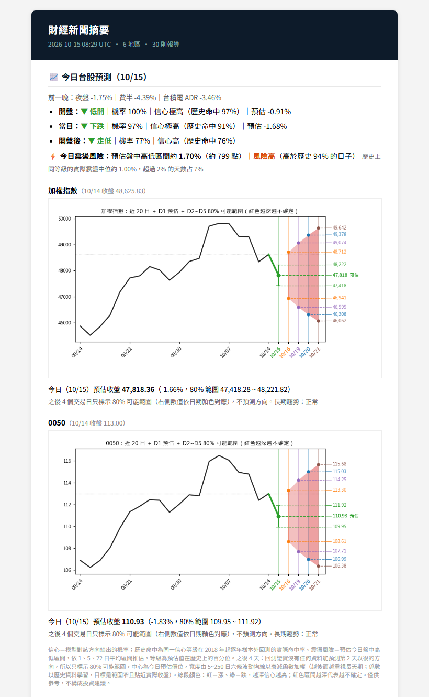
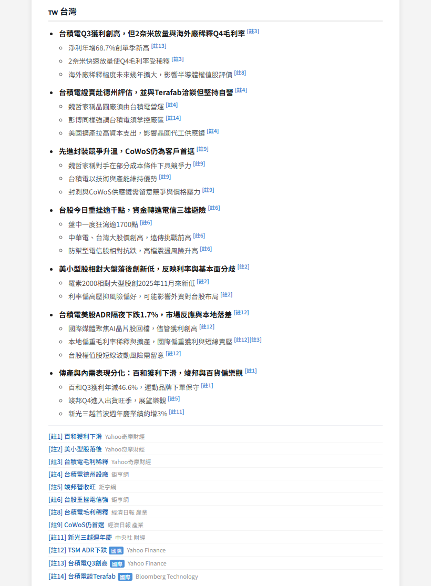
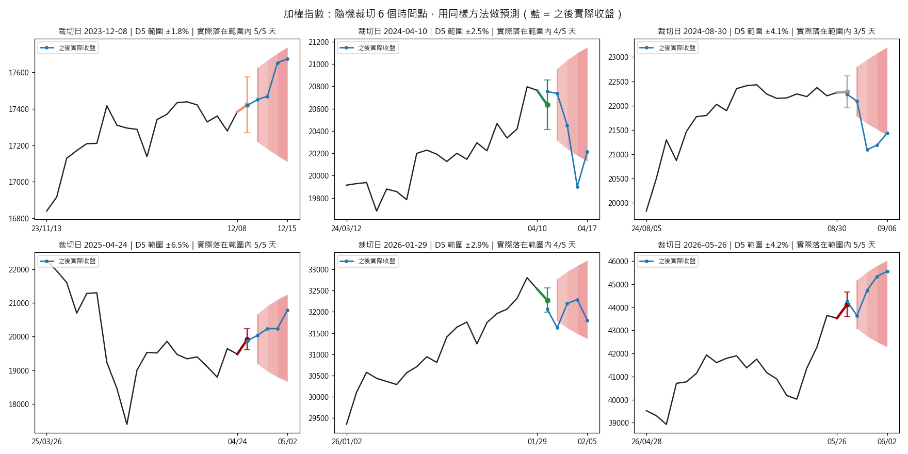
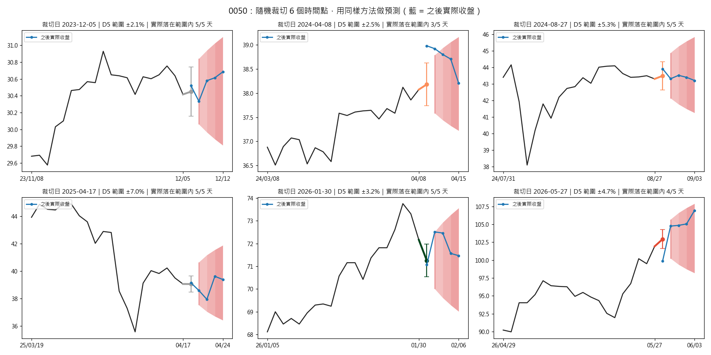
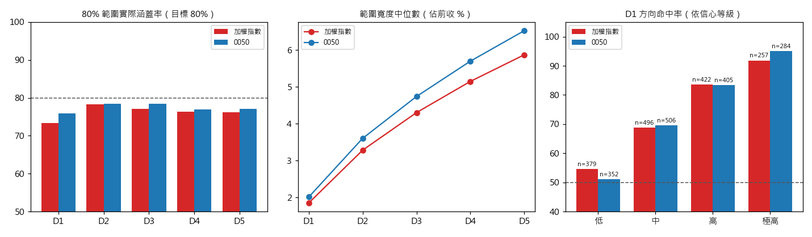

# TW NewsWorker — 台灣財經新聞摘要與台股開盤預測

每天早上 08:00（台北時間）自動執行：

1. 從 25 個國內外 RSS／API 來源抓取前一天的財經新聞
2. 以「詞頻突增（burst）＋跨來源聚類＋經濟相關度模型」挑出重要事件
3. 呼叫 Claude 依地區產生繁體中文重點摘要，並做第二層資格審查
4. 以「台指期夜盤＋費半＋台積電 ADR」預測台股當日開盤方向，並給出加權指數、0050 未來 5 個交易日的 80% 可能範圍
5. 組成 HTML Email 寄出；失敗時寄送監控告警

另有三個獨立的排程任務：市場資料快照、跨市場關聯監控、純數據週報（目前停用）。

## 範例畫面

**今日台股預測**（Email 開頭區塊）



**台灣新聞摘要**（每個地區一個區塊，[註N] 對應下方原文連結）



---

## 目錄結構

```
├── main.py                 # 主流程：爬蟲 → 選文 → 摘要 → 預測 → Email → 監控
├── config.json             # 新聞來源、關鍵字、選文／模型參數、排程時間
├── run.bat                 # Windows 排程器呼叫的入口（勿移動，排程寫死此路徑）
├── requirements.txt
├── .env.example            # 環境變數範本（複製成 .env 填入）
├── scheduler/              # Windows 工作排程器匯出的 XML（可直接匯入）
├── src/
│   ├── crawler.py          # 抓 RSS / JSON API、抓內文、台灣相關判斷
│   ├── selector.py         # burst 詞、事件聚類、事件評分、各地區選文
│   ├── relevance.py        # 經濟相關度分類器、台灣利多／利空評價
│   ├── history.py          # 歷史文章回補摘要、全量重新標註
│   ├── summarizer.py       # Claude 摘要 prompt 與輸出解析、回饋標籤
│   ├── claude_cli.py       # 呼叫 claude CLI
│   ├── emailer.py          # HTML Email 組版與寄送（Gmail SMTP）
│   ├── monitor.py          # 來源健康度與失敗告警
│   ├── tw_forecast.py      # 台股開盤預測、震盪風險、5 日範圍、圖表
│   ├── market_data.py      # Yahoo Finance 各地區指數快照
│   ├── twse_market.py      # 證交所加權指數 OHLC、0050 日線
│   ├── taifex.py           # 期交所台指期日盤／夜盤
│   ├── market_correlation.py  # 跨市場領先-落後關聯的滾動監控
│   └── weekly_report.py    # 純數據週報
├── docs/img/               # README 用的範例畫面與驗證圖
└── data/                   # 執行期資料（僅 data/relevance 的標註檔進版控）
    ├── <YYYY-MM-DD_HHMM>/  # 每次執行一個資料夾：news_raw / news_filtered / events / dropped / summary.md / articles/
    ├── term_daily/         # 每日詞頻快照（burst 基準）
    ├── relevance/          # 人工標註、回饋標籤、訓練好的分類器
    ├── market.db           # SQLite：所有市場資料
    ├── market_correlation.json
    ├── source_health.json
    └── last_run.txt        # 上次成功執行時間（決定新聞時間窗）
```

> `data/`、`logs/`、`.env` 不進版控。新環境 clone 後需依「資料回補」一節重建市場資料庫；新聞歷史資料無法回補，只能從部署日起累積。

---

## 安裝與設定

### 1. Python 環境

開發與執行環境為 Python 3.14（Windows）。

```bash
pip install -r requirements.txt
```

第一次執行會自動從 Hugging Face 下載 embedding 模型（約 1.1 GB），之後使用本機快取。

### 2. 環境變數

repo 只附範本 `.env.example`，不含任何帳密。請自行複製一份 `.env`，並填入自己的值：

```bash
copy .env.example .env
```

| 變數 | 說明 |
|---|---|
| `GMAIL_ADDRESS` | 寄件 Gmail |
| `GMAIL_APP_PASSWORD` | Gmail 應用程式密碼（需開兩步驟驗證後產生） |
| `RECIPIENT_EMAIL` | 收件人；可加 `RECIPIENT_EMAIL_2`、`RECIPIENT_EMAIL_3` |
| `CLAUDE_CODE_OAUTH_TOKEN` | 執行 `claude setup-token` 產生的長期 token（使用 Claude 訂閱） |

`claude` CLI 路徑的尋找順序：`config.json` 的 `claude_exe` → 環境變數 `CLAUDE_CODE_EXECPATH` → `%APPDATA%\Claude\claude-code\<版本>\claude.exe` → `PATH`。

### 3. 排程（Windows 工作排程器）

匯入 `scheduler/` 內的 XML（匯入前請把 XML 中的 Python 路徑改成你的安裝路徑）：

| 任務 | 時間 | 指令 |
|---|---|---|
| NewsWorker | 每日 08:00 | `run.bat`（= `python main.py --now`） |
| MarketCorrelation | 每日 07:30 | `python -m src.market_correlation` |
| MarketData | 每日 00:00 | `python -m src.market_data` |
| WeeklyReport | 每週六 09:00 | `python -m src.weekly_report`（`config.json` 中 `weekly_report.enabled=false` 時不寄送） |

所有任務都設定「喚醒電腦執行」，失敗時每 5 分鐘重試。

---

## 基本使用

```bash
# 立即執行一次完整流程（會寄信、會更新 last_run）
python main.py --now

# 試跑：不寄信、不更新 last_run、不寄告警，Email 預覽存到 data/<run>/email_preview.html
python main.py --now --no-email

# 常駐模式（APScheduler，依 config.json 的 schedule.daily 每日執行）
python main.py

# 個別模組
python -m src.market_data            # 更新 Yahoo 市場快照（近 5 天）
python -m src.twse_market            # 更新加權指數 OHLC（近 2 個月）與 0050
python -m src.taifex                 # 更新台指期（本月與上月）
python -m src.market_correlation     # 重算跨市場關聯並印出報表
python -m src.relevance              # 重新訓練經濟相關度分類器
```

**新聞時間窗**：只收「上次成功執行時間」與「現在 − 26 小時」兩者中較晚者之後發布的文章。摘要全數失敗時不寄信、也不推進 `last_run`，下次執行會補上這段時間的新聞。

---

## 資料回補

新環境建議依下列順序執行（證交所／期交所有頻率限制，程式每次請求間隔 3 秒，完整回補需數十分鐘）：

```bash
# 1. Yahoo Finance：關聯監控用的各地區指數 2 年日線 → prices 表
python -m src.market_data --backfill

# 2. 證交所
python -m src.twse_market --backfill-ohlc     # 10 年加權指數 OHLC → twse_ohlc；0050 10 年 OHLC → yahoo_ohlc

# 3. 期交所
python -m src.taifex --backfill               # 台指期近月日盤＋夜盤，自 2017-05 起 → taifex_tx
```

費半（`^SOX`）與台積電 ADR（`TSM`）由預測模組在每次執行時自動補抓近 5 天的資料。這兩檔的 10 年歷史目前沒有對應的回補指令，新環境需另外用 `yfinance` 回補。

新聞歷史相關（需先有 `data/<run>/news_raw.json`）：

```bash
python -m src.history backfill    # 對沒有 RSS 摘要的歷史文章抓網頁 og:description（可續跑）→ relevance/history_summaries.json
python -m src.relevance           # 以人工標籤＋回饋標籤重訓分類器 → relevance/classifier.json
python -m src.history annotate    # 全量重新打分，並重新校準台灣評價軸 → history_annotations.jsonl、tw_axis.json
```

`market.db` 資料表一覽：

| 資料表 | 來源 | 主鍵 | 內容 |
|---|---|---|---|
| `prices` | Yahoo Finance | symbol, trading_date | 加權、標普、那斯達克、費半、日經、韓股、DAX、FTSE、STOXX50、VIX、銅、台積電 ADR |
| `twse_ohlc` | 證交所 MI_5MINS_HIST | trading_date | 加權指數開高低收 |
| `twse_stock` | 證交所 STOCK_DAY | symbol, trading_date | 0050 原始（未還原）日線，用來補 Yahoo 缺漏 |
| `yahoo_ohlc` | Yahoo Finance | symbol, trading_date | 0050 還原 OHLC |
| `taifex_tx` | 期交所 | trading_date, session | 台指期近月（成交量最大的月合約）日盤／夜盤 |

所有寫入均為 `INSERT OR REPLACE`，重跑不會重複累加。

### 已捨棄的市場資料（無統計意義）

下列資料曾經收集，但經檢定對台股方向**沒有顯著的增量預測力**，已停止抓取與儲存：

- 美國：SPY、QQQ、10 年期公債殖利率
- 亞洲：恒生指數、2800.HK、EWJ、EWY
- 歐洲：EWG、EWU、FEZ
- 商品與匯率：WTI 原油、黃金、天然氣、美元指數、UUP
- 半導體：SOXX
- 證交所：全市場成交金額／筆數、三大法人買賣超
- 期交所：VIXTWN

**檢定方法**：以現行模型「夜盤＋費半＋台積電 ADR」為基準，逐一加入候選特徵 $f$，對「開盤／當日／開盤後」三個方向目標各做兩項檢定：

1. 概似比檢定（無懲罰邏輯迴歸）：$\text{LR}=2(\ell_{\text{基準}+f}-\ell_{\text{基準}})\sim\chi^2_1$；共 69 項檢定，以 Bonferroni 校正（$p\times 69$）
2. 逐年 walk-forward 樣本外 AUC 的增減

隔夜特徵的時間對齊方式與預測模組相同（海外交易日 $d$ 對應其後第一個台股交易日）。證交所資料一律取前一交易日的值，避免偷看當天資訊。

**結果**：沒有任何一項在校正後顯著，樣本外 AUC 增幅最多 0.004。

| 候選特徵 | 最小原始 p 值（目標） | Bonferroni 校正後 | 樣本外 AUC 增減 | 樣本數 |
|---|---|---|---|---|
| WTI 原油 | 0.0013（開盤） | 0.092 | +0.004 | 507 |
| 黃金 | 0.020（當日） | 1.00 | +0.003 | 507 |
| 天然氣 | 0.028（開盤） | 1.00 | +0.002 | 507 |
| EWJ | 0.030（當日） | 1.00 | −0.001 | 507 |
| FEZ／SOXX／EWU | 0.074～0.097（開盤） | 1.00 | ≤ +0.002 | 507 |
| 三大法人合計 | 0.083（開盤） | 1.00 | +0.000 | 2145 |
| 自營商買賣超 | 0.092（開盤） | 1.00 | +0.000 | 2145 |
| 投信買賣超 | 0.13（開盤） | 1.00 | −0.002 | 2145 |
| 外資買賣超 | 0.13（開盤後） | 1.00 | −0.001 | 2005 |
| 成交筆數／成交金額（相對 20 日均） | ≥ 0.29 | 1.00 | ≈0 | 2145 |
| UUP、EWG、EWY、美元指數、SPY、QQQ、10Y、恒生、2800.HK | ≥ 0.0998 | 1.00 | ≤ +0.002 | 491～508 |
| VIXTWN 變化 | 0.099（當日） | 1.00 | 樣本不足 | 69 |

VIXTWN 只有 69 筆（期交所僅公開近約 4 個月），無法驗證。0050 在 `prices` 表的資料與 `yahoo_ohlc` 重複，也一併移除。

---

## 人工標記與訓練檔案（`data/relevance/`）

| 檔案 | 用途 | 內容與規模 | 是否用於訓練 |
|---|---|---|---|
| `labels_20261005.json` | 經濟相關度人工標註（第一批） | `{"source_run": "2026-10-05_0800", "non_finance_idx": [...]}`：指定該次執行 `news_raw.json` 中 94 篇為非財經，其餘皆為財經 | ✅ |
| `labels_20261005_titles.json` | 補充人工標註 | 6 篇「概念／評論型、無直接市場影響」的標題，標為非財經 | ✅ |
| `labels_fulltext.json` | 全文審閱後的修正標註 | 4 篇財經、29 篇非財經；檔名排序在後，**覆蓋**前面的標題式標註 | ✅ |
| `feedback.jsonl` | Claude 第二層審查的回饋標籤（自動累積） | 每行 `{run, title, source, label, reason}`；目前 651 筆（487 符合／164 剔除） | ✅（人工標籤優先） |
| `eval_labels.json` | 評估用標註集 | 405 篇，`{label, by}`：275 篇人工（hand）、130 篇 Claude 判定 | ❌ 評估用 |
| `fulltext_truth.json` | 全文判讀對照 | 33 篇：全文真值、舊標註、是否一致、信心、理由，以及人工覆核欄位 `human_label` | ❌（結果已轉成 `labels_fulltext.json`） |
| `fulltext_truth_review.md` | 上表的審閱用表格 | — | — |
| `sentiment_labels.json` | 正／負面評價標註（Claude 盲判，待人工抽查） | 150 篇：正面 71、負面 46、中性 33；加 `"human"` 欄位可覆蓋 | ❌ 評估用 |
| `sentiment_review.md` | 上表的審閱用表格 | — | — |
| `tw_sentiment_labels.json` | 「對台灣」利多／利空標註 | 240 篇：利多 99、中性 60、利空 36、無關 45 | ❌ 用於驗證台灣評價軸 |
| `tw_sample_titles.json` | 上表的抽樣標題清單 | 240 篇 | — |
| `classifier.json` | 訓練好的經濟相關度分類器 | 768 維係數＋截距，n=795 | 推論用 |
| `tw_axis.json` | 台灣評價軸的校準參數 | center、scale、n=5278 | 推論用 |

**標籤合併規則**：`labels_*.json` 依檔名排序套用，後面的檔案覆蓋同標題的舊標籤；接著加入 `feedback.jsonl`，但同一標題若已有人工標籤，以人工為準。

**新增標註後重訓**：

```bash
python -m src.relevance
```

會印出 5-fold 交叉驗證 AUC，以及門檻 0.3／0.4／0.5／0.6 下的財經保留率與非財經剔除率。主流程每次摘要完成後也會自動重訓一次。

> `labels_20261005.json` 需要對應的 `data/2026-10-05_0800/news_raw.json` 才能讀取；該資料夾不在版控中，在新環境重訓前需另行取得。

---

## 採用模型

| 用途 | 模型 | 連結 |
|---|---|---|
| 文章向量（經濟相關度、台灣評價） | **intfloat/multilingual-e5-base**（768 維，CPU 推論） | <https://huggingface.co/intfloat/multilingual-e5-base> |
| 曾比較、未採用 | intfloat/multilingual-e5-small（384 維） | <https://huggingface.co/intfloat/multilingual-e5-small> |
| 曾比較、未採用 | intfloat/multilingual-e5-large（1024 維） | <https://huggingface.co/intfloat/multilingual-e5-large> |
| 中文斷詞 | jieba（加入 `config.json` 的中文關鍵字為自訂詞典） | <https://github.com/fxsjy/jieba> |
| 日文斷詞 | fugashi + unidic-lite | <https://github.com/polm/fugashi> |
| 摘要與第二層審查 | Claude（經由 `claude -p` CLI，使用 CLI 預設模型） | — |

E5 的輸入一律加上 `query: ` 前綴，並做 L2 正規化。分類器檔案記錄訓練時的模型名稱，與目前模型不一致時會停用並提示重訓。

---

## 新聞選文公式

### 1. 斷詞

每則標題抽出詞集合 $T_i$：

- 拉丁字母：`[A-Za-z][A-Za-z&.-]{2,}`，轉小寫，去除英文停用詞
- 中文：jieba 斷詞，保留長度 ≥ 2 的純漢字詞
- 日文：fugashi 斷詞，並把 `config.json` 日文關鍵字中被切開的 2～3 個片段黏回去

### 2. Burst（今日突增）分數

對今日出現的每個詞 $t$：

$$
p_{\text{today}}(t)=\frac{df_{\text{today}}(t)}{N_{\text{today}}},\qquad
p_{\text{hist}}(t)=\frac{df_{\text{hist}}(t)+0.5}{\max(N_{\text{hist}},\,100)+0.5}
$$

$$
\text{burst}(t)=\ln\frac{p_{\text{today}}(t)}{p_{\text{hist}}(t)}
$$

- $df$ 為含該詞的標題數，$N$ 為標題總數
- 歷史基準 = 執行日前 `baseline_window_days`（7）天的每日快照加總；若 $N_{\text{hist}}<$ `min_baseline_docs_floor`（1000），再納入所有更早的快照
- 每日快照存在 `data/term_daily/YYYY-MM-DD.json`，同日重跑覆寫而非累加

**顯著詞**：$\text{burst}(t)\ge$ `min_burst_score`（1.0），且純漢字詞必須存在於 jieba 詞典（排除斷詞失敗產生的碎片）。

$$
S_i=\{t\in T_i \mid \text{burst}(t)\ge 1.0 \wedge \text{trustworthy}(t)\}
$$

### 3. 經濟相關度閘門（第一層）

$$
x_i=\text{E5}\big(\texttt{"query: "}+\text{title}+\texttt{". "}+\text{summary}_{[:300]}\big),\qquad
P_i=\sigma(w^\top x_i+b)
$$

$w,b$ 為邏輯迴歸（`C=8`、`class_weight="balanced"`）以人工標籤＋回饋標籤訓練。

剔除條件（被剔除者不參與聚類與選文，但仍計入當日詞頻）：

$$
\text{drop}_i=
\begin{cases}
P_i<0.30 & \text{標題命中 config 關鍵字}\\
P_i<0.40 & \text{否則}
\end{cases}
$$

關鍵字比對：英文用單字邊界，中日文用子字串。

### 4. 事件聚類（增量式中心聚類）

依序處理每篇文章，與現有事件比對。事件的比對簽名：

$$
\text{sig}(E)=
\begin{cases}
\text{唯一成員的全部顯著詞} & |E|=1\\
\{t \mid t \text{ 在 } E \text{ 中至少 2 篇出現}\} & |E|\ge 2
\end{cases}
$$

文章 $i$ 可併入事件 $E$ 的條件（取共享詞最多者）：

$$
|S_i\cap\text{sig}(E)|\ge 2 \;\;\text{或}\;\; \frac{|S_i\cap\text{sig}(E)|}{|S_i\cup\text{sig}(E)|}\ge 0.34,\qquad |E|<8
$$

這樣做是為了避免 union-find 的遞移串連，也就是 A-B、B-C 各共享不同詞時，A 和 C 被硬串在一起。

### 5. 事件分數

$$
\text{score}(E)=\Big(\sum_{t\in\bigcup_{i\in E}S_i}\text{burst}(t)\Big)\times\big(1+0.8\,(|\text{sources}(E)|-1)\big)
$$

再依序調整：

- 任一成員命中關鍵字：$\text{score}\mathrel{+}=2.0$（`keyword_bonus`）
- 否則若 $\max_{i\in E}P_i<0.6$：$\text{score}\mathrel{\times}=0.5$（`penalty_factor`）

### 6. 各地區選文

- 事件只歸屬「主要地區」，也就是成員數最多的地區（同數時取名稱排序較前者），避免跨地區事件重複占名額
- 每地區取分數前 `top_n_per_region`（6）個事件
- 每事件最多 `max_articles_per_event`（2）篇，來源不重複、標題不重複，優先取詞數較多的標題

### 7. 經濟相關度分級（給摘要模型參考）

$$
\text{tier}_i=
\begin{cases}
\text{低} & P_i<\text{floor}_i\\
\text{高} & P_i\ge 0.5 \wedge \text{含具體數據}\\
\text{中} & \text{其他}
\end{cases}
$$

「含具體數據」= 正規表示式比對到「數字＋單位／幣別」，例如 `3.2%`、`$20bn`、`1.17兆`、`50 bps`。抓到全文後，若原為「中」、$P_i\ge 0.5$ 且全文含數據，升為「高」。

### 8. 台灣利多／利空評價（零樣本）

以固定的正、反原型句定義評價軸：

$$
a=\overline{\text{E5}(\text{利多原型})}-\overline{\text{E5}(\text{利空原型})},\qquad
r_i=x_i^\top a
$$

$$
z_i=\frac{r_i-\mu}{s},\qquad
\text{label}_i=
\begin{cases}
\text{利多} & z_i\ge 0.5\\
\text{利空} & z_i\le -0.5\\
\text{中性} & \text{其他}
\end{cases},\qquad
\text{conf}_i=\min\!\Big(1,\frac{|z_i|}{2}\Big)
$$

- $\mu,s$ 為歷史上「台灣相關且經濟分級非低」文章的 $r$ 平均與標準差（`tw_axis.json`，n=5278），由 `python -m src.history annotate` 重新校準
- 只對台灣相關文章給評價：地區為「台灣」，或標題／內文含 `taiwan`、`tsmc`、`foxconn`、`mediatek`、`hon hai` 等關鍵字

### 9. 第二層審查與回饋迴圈

Claude 依「是否對台灣經濟有影響」逐篇審查，不符合者列入 `[REJECT]`。審查結果寫入 `feedback.jsonl`（符合 = 1、剔除 = 0），作為下次重訓第一層分類器的標籤。

---

## 台股預測公式（`tw_forecast.py`）

只在台股交易日產生（週一～五，且不在證交所休市日曆中）。

### 1. 目標變數

以加權指數 $O_t$（開盤）、$C_t$（收盤）定義：

$$
\text{gap}_t=\ln\frac{O_t}{C_{t-1}},\qquad
\text{ret}_t=\ln\frac{C_t}{C_{t-1}},\qquad
\text{intra}_t=\ln\frac{C_t}{O_t}
$$

分別對應郵件中的「開盤」「當日」「開盤後」。

### 2. 隔夜特徵（台北 08:00 前皆已收盤）

$$
\text{夜盤}_t=\ln\frac{\text{夜盤收盤}_t}{\text{日盤收盤}_{t-1}}\quad(\text{僅限同一近月合約，換月日視為缺值})
$$

$$
\text{費半}_t=\sum_{d\in(\text{上一台股交易日},\,t)}\ln\frac{\text{SOX}_d}{\text{SOX}_{d-1}},\qquad
\text{台積電ADR}_t=\sum_{d}\ln\frac{\text{TSM}_d}{\text{TSM}_{d-1}}
$$

美股交易日 $d$ 對應到其後第一個台股交易日。任一特徵缺值時，改用其餘可用特徵重新擬合。

### 3. 方向與信心

$$
P_{\text{up}}=\sigma\big(\beta^\top\,\text{standardize}(X)\big),\qquad
\text{conf}=\max(P_{\text{up}},\,1-P_{\text{up}})
$$

| 信心 | 等級 |
|---|---|
| ≥ 0.90 | 極高（「開盤後」最高只給到「高」） |
| ≥ 0.75 | 高 |
| ≥ 0.60 | 中 |
| < 0.60 | 低 |

- 預估幅度：同一組特徵的線性迴歸 $\hat y=\gamma^\top X$
- 每個等級的**歷史命中率**用逐年 walk-forward 計算：第 $y$ 年只用 $y$ 年以前的資料訓練（至少 200 筆），屬於樣本外結果
- 每次執行都用資料庫中全部歷史重新擬合

### 4. 當日震盪風險

$$
h_t=\ln\frac{H_t}{L_t},\qquad
\ln h_t=\alpha_0+\alpha_1 h_{t-1}+\alpha_2\,\overline{h}_{5}+\alpha_3\,\overline{h}_{22}
$$

預測值 $\hat h=e^{\widehat{\ln h}}$，以歷史預測值的百分位分級：< 33% 低、33～75% 中、75～95% 高、> 95% 極高。各級的實際中位數振幅，以及振幅 > 2% 的比例，由逐年 walk-forward 回測計算。預估點數 = $\hat h\times$ 最新收盤。

### 5. 加權指數與 0050 的 5 日預測

**D1（下一交易日）**：

$$
\hat d_1=\text{LinearRegression}(X)\;\text{預測對數報酬},\qquad
\hat p_1=C_0\,e^{\hat d_1}
$$

$$
s_1=\text{std}(\text{樣本外 D1 殘差，最近 2000 筆}),\qquad
s_{1d}=c_1\, s_1\left(\frac{v_{20}}{v_{250}}\right)^{\kappa}
$$

$$
P_{\text{up}}=\Phi\!\left(\frac{\hat d_1}{s_{1d}}\right),\qquad
\text{D1 80\% 範圍}=\hat p_1\,e^{\pm z_{0.9}\,s_{1d}},\quad z_{0.9}=1.28155
$$

**D2～D5**：不給點位與方向（回測顯示無任何指標能預測第 2 天以後的方向），只給以 $\hat p_1$ 為中心的 80% 範圍。

波動視窗 $L\in\{5,10,20,60,120,250\}$：

$$
v_5=\sqrt{\tfrac{1}{5}\textstyle\sum r^2},\qquad v_L=\text{std}_L(r)\;(L\ge 10)
$$

第 $k$ 步的衰減核權重（中心隨步數往長天期移動）：

$$
w_{k,L}=\frac{\exp\!\big(-\theta\,|\ln L-\ln(L_0 k)|\big)}{\sum_{L'}\exp\!\big(-\theta\,|\ln L'-\ln(L_0 k)|\big)}
$$

$$
\sigma_h=c\sqrt{s_{1d}^2+\sum_{k=1}^{h-1}\sum_L w_{k,L}\,v_L^2},\qquad
\text{D}h\text{ 80\% 範圍}=\hat p_1\,e^{\pm z_{0.9}\,\sigma_h}
$$

權重為正且總和為 1，所以範圍只會隨天數變寬，上下界不會交叉。

**參數學習**：在最近約 2000 個交易日上，以網格搜尋最小化 interval score：

$$
\text{IS}=\overline{(\text{hi}-\text{lo})+10\big[\max(\text{lo}-y,0)+\max(y-\text{hi},0)\big]}
$$

其中 $y=\ln C_{t+h}-\ln C_t-\hat d_{1,t+1}$。搜尋範圍：

| 參數 | 範圍 |
|---|---|
| $c_1$ | 0.70～1.30，間隔 0.05 |
| $\kappa$ | {0, 0.25, 0.5, 0.75, 1} |
| $L_0$ | {3, 5, 10, 20, 40} |
| $\theta$ | {0.5, 1, 2, 4} |
| $c$ | 0.75～1.25，間隔 0.05 |

D1 的 $\hat d_1$ 歷史序列採逐年樣本外預測；樣本外不足 250 筆時退回樣本內。

### 6. 長期趨勢檢查

$$
z_t=\frac{\ln(C_t/\text{MA}_{60})}{\text{std}_{250}\big(\ln(C/\text{MA}_{60})\big)}
$$

- $z>2$：過熱
- 最近 11 個交易日內出現 $z$ 由 > 2 跌回 ≤ 2：降溫整理（歷史上之後 1～2 週偏弱）
- 處於「降溫整理」且 D1 $P_{\text{up}}\ge 0.6$：郵件標示「牴觸」

0050 使用 Yahoo 的還原收盤價，Yahoo 缺漏的最近交易日以證交所原始收盤補上。

### 7. 驗證（逐年樣本外回測）

2020～2026 年的每一年 $Y$，所有模型都只用 $Y$ 年以前的資料擬合，再套用到 $Y$ 年的每個交易日，完全模擬當時能做出的預測。被擬合的部分包括：D1 迴歸、樣本外誤差 $s_1$，以及範圍參數 $c_1,\kappa,L_0,\theta,c$。

**隨機裁切 6 個時間點**：黑線為裁切日前 20 日收盤，D1 點的顏色代表信心等級，紅色區塊為 D2～D5 的 80% 範圍，藍線為之後的實際收盤。





**整體統計**：



| 指標 | 加權指數 | 0050 |
|---|---|---|
| 樣本天數 | 1,554 | 1,547 |
| D1 方向命中率 | 73.2% | 73.7% |
| D1 命中率：極高／高／中／低 | 91.8%／83.6%／68.8%／54.6% | 95.1%／83.5%／69.6%／51.1% |
| 80% 範圍涵蓋率 D1～D5 | 73.3%／78.4%／77.1%／76.3%／76.2% | 75.9%／78.5%／78.5%／76.9%／77.1% |
| 範圍寬度中位數 D1～D5（佔前收） | 1.9%／3.3%／4.3%／5.1%／5.9% | 2.0%／3.6%／4.7%／5.7%／6.5% |

信心等級和命中率呈單調關係，表示信心值有鑑別力。80% 範圍的實際涵蓋率在 73～79% 之間，略低於目標，D1 最明顯，表示範圍偏窄。

---

## 跨市場關聯監控（`market_correlation.py`）

收錄已通過三項驗證的領先-落後關係：方向不對稱、偏相關不塌陷、前後半期同號且 $|\rho|>0.15$。

| 類別 | 關係 |
|---|---|
| 美股隔夜 → 亞股 | 費半／標普／那斯達克 → 台股、日經、韓股（lag = 1） |
| 歐股同日 → 美股 | DAX／FTSE／STOXX50 → 標普（lag = 0） |
| 亞股同日 → 歐股 | 日經／台股 → DAX、STOXX50（lag = 0） |
| 宏觀因子隔夜 → 亞股 | VIX／銅 → 台股、日經、韓股（lag = 1） |

模組載入時會依各交易所實際收盤時間（UTC）檢查每組關係的 lag 方向，確保 A 確實比 B 早收盤。

**公式**：

$$
r_{X,d}=\ln\frac{P_{X,d}}{P_{X,d-1}}\quad(\text{各標的在自己的交易日曆上計算後才合併})
$$

$$
\rho_t=\text{Spearman}\big(r_A,\; r_B\text{ 往後位移 lag}\big)\;\text{於最近 }60\text{ 個交易日（至少 45 筆）}
$$

$$
\mu,\sigma=\text{排除最近 63 個滾動值後的平均與標準差},\qquad
z_t=\frac{\rho_t-\mu}{\sigma}
$$

- 偏離：$|z_{\text{latest}}|>2$
- 方向：$(\rho-\mu)\cdot\text{sign}(\mu)>0$ 為「轉強」，否則為「轉弱／翻轉」
- 偏離的關係會依地區附加到摘要 prompt 的「市場數據背景參考」；結果檔超過 48 小時視為過期，不採用

參數在 `config.json` 的 `market_correlation` 區塊。

---

## 週報（`weekly_report.py`，目前停用）

純數據、不經 LLM。對每個標的：

$$
\text{漲跌幅}=\frac{\text{區間內最後交易日收盤}}{\text{區間內第一個交易日收盤}}-1
$$

區間分別為本週（週一～週五）、上週、去年同期（往前 364 天）。

---

## 監控與告警

- 單一來源連續失敗達 `source_failure_alert_threshold`（6）次時寄告警，恢復後重置計數
- 流程失敗（爬蟲崩潰、摘要全數失敗、Claude 認證失效、Gmail 寄送失敗）時寄出告警，附最後 60 行 log
- 來源健康狀態記錄在 `data/source_health.json`

---

## 注意事項

- `.env` 需由使用者依 `.env.example` 自行建立，內含個人的 Gmail 應用程式密碼與 Claude token。`.gitignore` 已排除此檔。
- 證交所與期交所會封鎖請求過快的用戶端，請勿調低 `_DELAY`。
- `bloomberg.com` 會擋爬蟲，設定在 `skip_fetch_domains` 中，改用 RSS 摘要代替全文。
- 本專案輸出僅供參考，不構成投資建議。
